<div align="center">

# 🏎️ F1 Race Prediction Simulator

**A lap-by-lap Formula 1 race simulator for the 2026 season that blends a Monte Carlo race engine, real F1 results and lap times, and a machine-learning model trained on 191 real races.**

<br>


[Video](#-promo-video) •
[Screenshots](#-screenshots) •
[Features](#-features) •
[Quick start](#-quick-start) •
[How it works](#-how-it-works) •
[Real data](#-real-f1-data) •
[ML model](#-machine-learning-model) •
[Track record](#-prediction-track-record) •
[Charts](#-charts)

<br>

### 🎬 Promo Video

<a href="docs/video/f1-race-prediction-promo.mp4">
  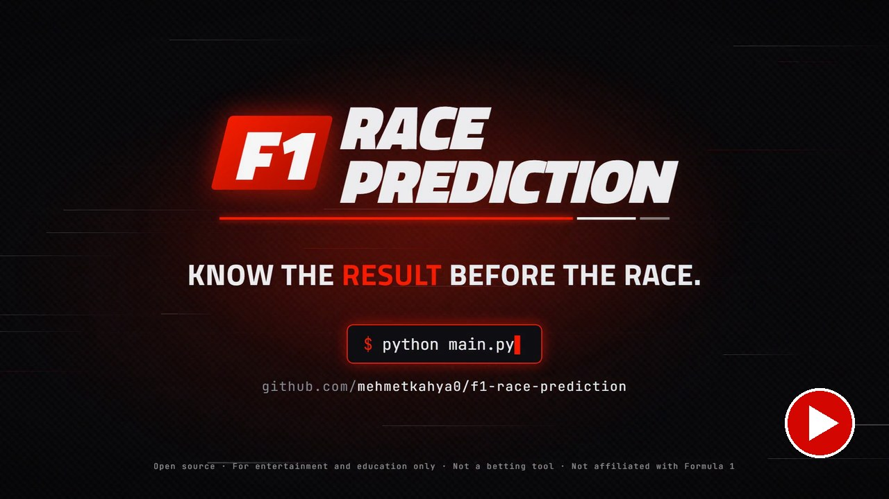
</a>

<sub>▶ Click the image to watch the 50-second promo (1080p, MP4).</sub>

</div>

> [!WARNING]
> All predictions are for **entertainment and educational purposes only**. They come from statistical models and historical data; real races depend on countless unpredictable factors. This is not a betting tool.

---

## 📋 Table of Contents

- [🎬 Promo Video](#-promo-video)
- [📸 Screenshots](#-screenshots)
- [✨ Features](#-features)
- [🚀 Quick Start](#-quick-start)
- [🎮 Usage](#-usage)
- [🧠 How It Works](#-how-it-works)
  - [Architecture](#architecture)
  - [Qualifying](#1-qualifying)
  - [Race pace](#2-race-pace-per-lap)
  - [Pit stops](#3-pit-stops)
  - [Incidents](#4-incidents)
  - [Points](#5-points)
  - [Weather](#6-weather)
  - [Hybrid prediction](#7-hybrid-prediction-simulation--real-data--ml)
- [📡 Real F1 Data](#-real-f1-data)
- [🤖 Machine Learning Model](#-machine-learning-model)
- [📊 Prediction Track Record](#-prediction-track-record)
- [📈 Charts](#-charts)
- [🏁 2026 Grid & Calendar](#-2026-grid--calendar)
- [📁 Project Structure](#-project-structure)
- [🛠️ Troubleshooting](#%EF%B8%8F-troubleshooting)
- [🗺️ Roadmap](#%EF%B8%8F-roadmap)

---

## 📸 Screenshots

All screenshots are real output of `python main.py` for a dry **Singapore Grand Prix** (Marina Bay).

<p align="center">
  <b>Race results</b><br>
  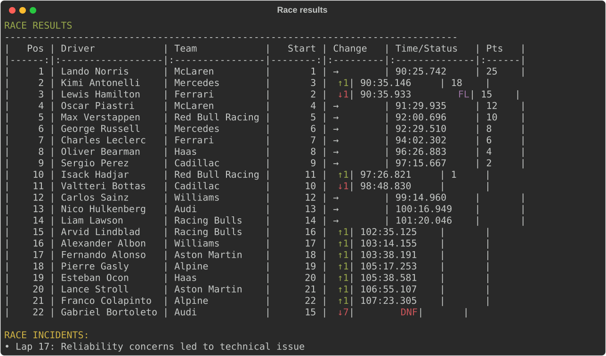
</p>

<table>
<tr>
<td width="50%" valign="top">

**Start screen & 2026 calendar**

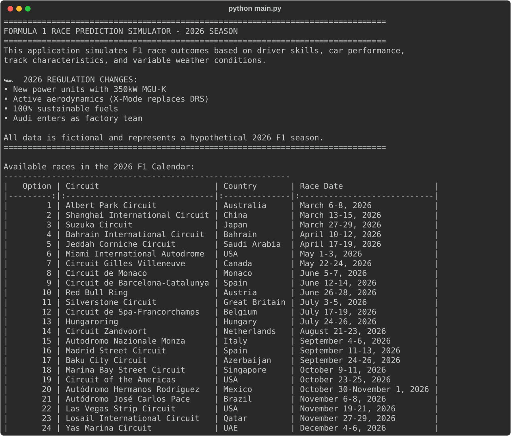

</td>
<td width="50%" valign="top">

**Real data integration summary**

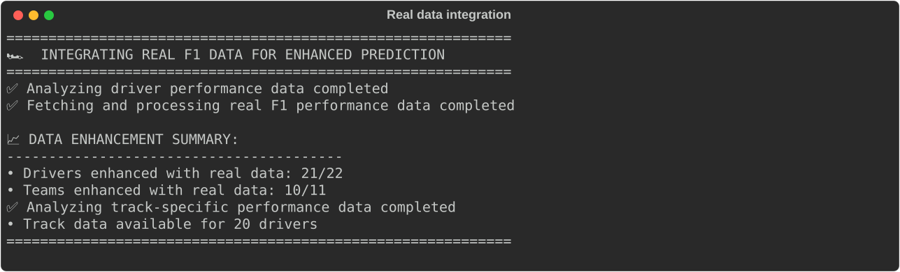

**Qualifying**

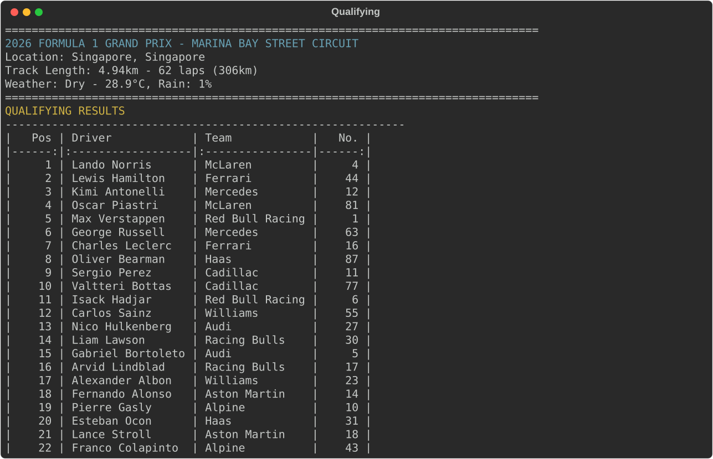

</td>
</tr>
<tr>
<td width="50%" valign="top">

**ML win & podium probabilities** (analysis menu → 4)

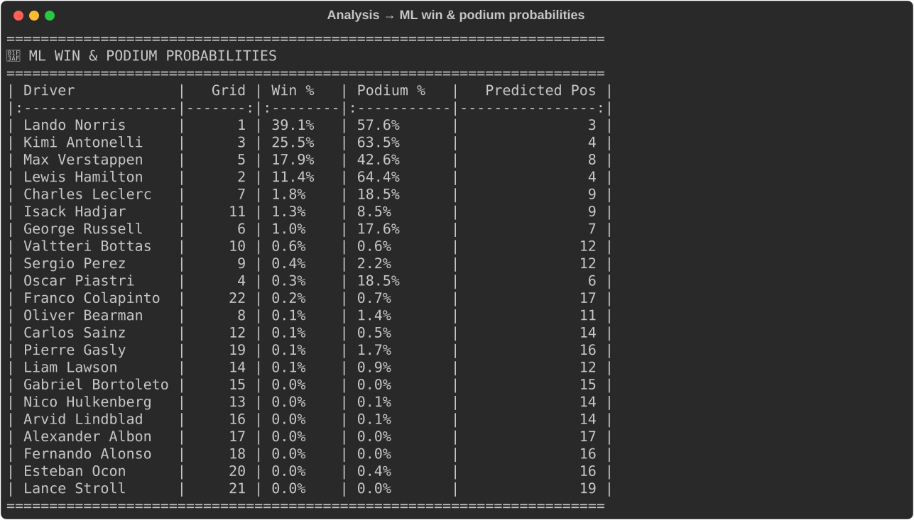

</td>
<td width="50%" valign="top">

**Real F1 data insights** (analysis menu → 3)

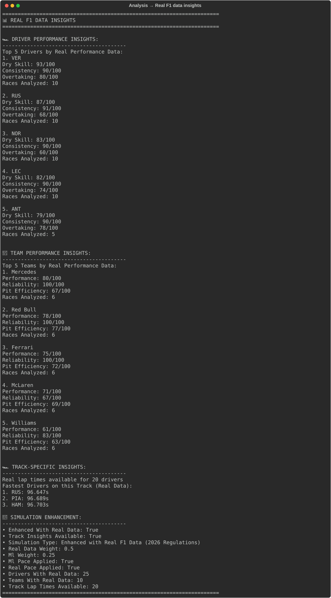

</td>
</tr>
<tr>
<td colspan="2" align="center">

**Qualifying vs race** (analysis menu → 1)

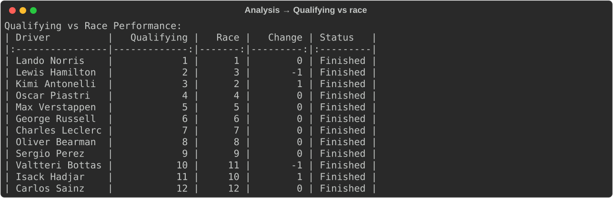

</td>
</tr>
</table>

---

## ✨ Features

| | Feature | Details |
|---|---|---|
| 🏁 | **Full race weekend** | Q1/Q2/Q3 qualifying, then a lap-by-lap race over the full distance |
| ⛽ | **Race physics** | Tyre wear, fuel burn-off, track-specific downforce/aero/energy modifiers |
| 🔧 | **Pit stops** | Pit plan from tyre life per track, pit-lane loss and team-dependent stationary times |
| 💥 | **Incidents** | Mechanical and energy-system failures, driver errors, collisions, punctures, weather crashes, pit errors, penalties, each with its lap number |
| 🌦️ | **Weather** | Location- and season-based dry / wet / mixed conditions, or forced by the user |
| 📡 | **Real data** | 2025 race results and lap-by-lap times (no F1 account needed) adjust ratings, grid and race pace |
| 🤖 | **Machine learning** | Random Forest trained on 191 real races (2018–2026) shifts each driver's pace; win and podium classifiers |
| 🏆 | **Correct points** | 25-18-15-12-10-8-6-4-2-1, recalculated after every result change, no fastest-lap point (removed in 2025) |
| 📈 | **Charts** | 7 chart types saved as PNG |

### 2026 regulations in the model

| Regulation | How it is modelled |
|---|---|
| **Power unit** (350 kW MGU-K) | Team `energy_recovery` rating × track `energy_demand` (up to 1.5% lap time) and a new failure type: energy-system failure |
| **Active aero** (X-Mode replaces DRS) | Team `active_aero` rating × track `active_aero_advantage` (up to 2% lap time); less effective in the wet |
| **New teams** | Audi factory team (ex-Sauber) and Cadillac as the 11th team |
| **Points** | No bonus point for the fastest lap |

---

## 🚀 Quick Start

### Requirements

| | |
|---|---|
| Python | **3.10 or newer** (developed on 3.12) |
| Disk | ~500 MB for the data cache |
| Internet | Only for the first run (data is cached afterwards) |
| F1 account | **Not needed** |

### Install

```bash
git clone https://github.com/mehmetkahya0/f1-race-prediction.git
cd f1-race-prediction

# optional: virtual environment
python -m venv venv
.\venv\Scripts\activate        # Windows
source venv/bin/activate       # Linux / macOS

pip install -r requirements.txt
```

### Run

```bash
python main.py
```

> [!NOTE]
> The **first run takes about 2 minutes**: it downloads results and lap times of ~10 races (~125 API requests). Everything is cached in `cache/`, so later runs start in seconds.

### Dependencies

| Package | Version | Used for |
|---|---|---|
| `numpy` | ≥ 2.0 | Numerics |
| `pandas` | ≥ 1.3 | Data handling |
| `matplotlib` / `seaborn` | ≥ 3.9 / ≥ 0.11 | Charts |
| `scikit-learn` | ≥ 1.6 | ML model (trained with 1.6.1) |
| `xgboost` | ≥ 3.0 | Model comparison (trained with 3.4.1) |
| `joblib` | ≥ 1.3 | Loading the trained model |
| `fastf1` | ≥ 3.0 | Event schedule + Jolpica/Ergast client |
| `tabulate` / `colorama` | | Terminal tables and colours |
| `requests` / `scipy` | | HTTP, statistics |

---

## 🎮 Usage

```
python main.py
  │
  ├─ 1. Pick a race ............ 1–24 from the 2026 calendar
  ├─ 2. Pick the weather ....... Realistic / Dry / Wet / Mixed
  ├─ 3. Real data is loaded .... drivers, teams, this track's lap times
  ├─ 4. Qualifying + race ...... results, points, incidents
  └─ 5. Analysis menu
```

### Analysis menu

| # | Option | What you get |
|:-:|---|---|
| 1 | Qualifying vs race performance | Grid vs finish and positions gained per driver |
| 2 | Detailed race statistics | Finishers, DNFs, DSQs, DNF rate, average gap |
| 3 | Real F1 data insights | Top drivers/teams by real data, fastest drivers at this track, which data was applied |
| 4 | ML win & podium probabilities | Win %, podium % and predicted position for every driver |
| 5 | Basic race progress | Position chart and a text replay of the race |
| 6 | Advanced visualizations | Tyre degradation, lap times, driver comparison, team analysis |
| 7 | Generate all visualizations | Saves every chart to `visualized-graphs/` |
| 8 | Simulate another race | Back to race selection |
| 9 | Quit | |

---

## 🧠 How It Works

### Architecture

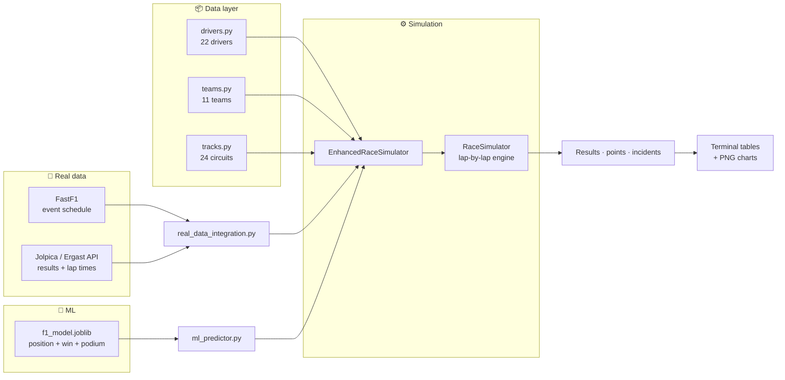

| Module | Responsibility |
|---|---|
| `data/drivers.py`, `teams.py`, `tracks.py` | Ratings for the 2026 grid and calendar |
| `data/real_data_integration.py` | Fetches real results/lap times, turns them into ratings and per-track pace |
| `models/race_model.py` | Core engine: qualifying, lap-by-lap race, pit stops, incidents, points |
| `models/enhanced_race_model.py` | Adds real-data and ML pace offsets and post-race adjustments |
| `models/ml_predictor.py`, `trained_model.py` | Loads the trained model and rebuilds its features for the current grid |
| `models/strategy.py` | Tyre strategy and pit stop times |
| `models/weather.py` | Weather generation |
| `utils/` | Tables, charts, statistics, loading animations |

### 1. Qualifying

Each driver sets one lap time, then Q1/Q2/Q3 variations are applied and the best one counts:

```
T_base   = 90 + (track_length_km − 5) × 4.5
T_quali  = (T_base + 4.0·(1 − driver_q) + 3.0·(1 − car_q) + weather + ε) × track_modifier
ε        ~ N(0, 0.15 · (1 − consistency/2))
```

| Term | Source |
|---|---|
| `driver_q` | `0.40·qualifying_pace + 0.35·skill_dry + 0.15·consistency + 0.10·aggression` |
| `car_q` | `0.20·performance + 0.25·power + 0.25·aerodynamics + 0.20·active_aero + 0.10·energy_recovery` |
| `weather` | Dry: `0.3·(1 − skill_dry)`. Wet: `3.0·(1 − skill_wet) + 0.5·active_aero` |

### 2. Race pace (per lap)

```
lap = (T_base + 2.5·(1 − driver_r) + 2.0·(1 − car_r) + weather + tyre + fuel + ε) × track_modifier
      + ML offset + real-data offset
```

| Term | Formula |
|---|---|
| `driver_r` | `0.30·skill_dry + 0.25·consistency + 0.20·tire_management + 0.15·racecraft + 0.10·overtaking` |
| `car_r` | `0.25·performance + 0.20·reliability + 0.20·energy_recovery + 0.20·aerodynamics + 0.15·power` |
| `tyre` | `tyre_age × 0.03 × (1.3 − 0.3·tire_management) × tyre_wear / 5` |
| `fuel` | `−0.025 × lap / (total_laps / 10)` (cars get faster as fuel burns) |
| `ε` | `N(0, 0.1 · (1 − 0.6·consistency))` |
| `track_modifier` | `1 − 0.02·aero_fit − 0.015·energy_fit − 0.01·(aero on high-downforce or power on low-downforce tracks)` |

### 3. Pit stops

`models/strategy.py` plans stops from each compound's expected life on the track. In the race:

```python
PIT_LANE_LOSS = 20.0   # seconds lost driving through the pit lane
PIT_LAP_JITTER = 3     # each driver pits within ±3 laps of the planned lap

stop = simulate_pit_stop(team.pit_efficiency)   # stationary time + possible errors
race_time += PIT_LANE_LOSS + stop['duration']
tyre_age = 0
```

Compound pace differences and undercut/overcut effects are not modelled.

### 4. Incidents

Every lap, every driver has a small chance of an incident (base 0.08%, capped at 10% per lap):

| Factor | Effect |
|---|---|
| Driver consistency | `1.8 − 1.2·consistency` |
| Car reliability | `1.8 − 1.4·reliability` |
| Energy system | `1.3 − 0.5·energy_recovery` |
| Weather | ×3.5 wet, ×2.2 mixed |
| Laps 1–2 | ×6.0 |
| Last 15% of the race | ×1.8 |
| Rookie (< 3 years) | ×1.4 |
| Aggression | `1 + 0.6·aggression` |

Incident types: energy-system failure, mechanical failure, driver error, collision, puncture, weather-related, pit error, penalty (DSQ). The lap number is recorded and shown, for example `Lap 17: …`.

### 5. Points

```python
POINTS_SYSTEM = [25, 18, 15, 12, 10, 8, 6, 4, 2, 1]   # no fastest-lap point since 2025
```

`assign_points()` runs at the end of the race **and again after the real-data adjustments**, so a driver who is moved or turned into a DNF afterwards always gets the right points.

### 6. Weather

| Input | Effect |
|---|---|
| Base | 70% dry · 20% wet · 10% mixed |
| Rain-prone countries (Japan, Brazil, Belgium, Great Britain, Singapore, …) | −20% dry |
| March, April, October, November | −10% dry |
| Temperature | 22 °C + month offset (−5…+7) + location offset (−3…+8) ± 3 °C |

You can also force dry, wet or mixed conditions from the menu.

### 7. Hybrid prediction: simulation + real data + ML

`EnhancedRaceSimulator` combines three sources:

| Source | What it changes | Weight |
|---|---|---|
| 🎲 **Monte Carlo engine** | Every lap time (formulas above) | — |
| 📡 **Real data** | Driver/team ratings (70% real, 30% base), qualifying order, **per-lap pace** from each driver's real gap to the field median at this track, post-race adjustments | `REAL_DATA_WEIGHT = 0.5`, clipped to ±2 s/lap |
| 🤖 **ML model** | **Per-lap pace** from the ML expected finishing position, centred on the field | `ML_WEIGHT = 0.25` |

```python
# ML offset (s/lap)
offset = ML_WEIGHT × ML_SECONDS_PER_POSITION × (expected_position − field_mean)
ML_SECONDS_PER_POSITION = 0.6   # typical per-lap gap between consecutive finishers

# Real-data offset (s/lap)
offset = clip(REAL_DATA_WEIGHT × (driver_real_lap − median_real_lap), −2.0, +2.0)
```

Over 40 seeded races the ML layer moves drivers it disagrees with by up to ~1.6 positions. Drivers the simulation and the ML agree on stay where they are.

---

## 📡 Real F1 Data

> [!IMPORTANT]
> FastF1's own timing data (`Session.load()`) now requires an **F1 TV account**. This project does **not** use it. All real data comes from sources that need no sign-in.

| Data | Source | Sign-in |
|---|---|:-:|
| Event schedule (rounds, cities) | `fastf1.get_event_schedule()` | ❌ |
| Race results (grid, position, points, status) | [Jolpica](https://api.jolpi.ca) (Ergast successor) through `fastf1.ergast` | ❌ |
| Lap-by-lap times and positions | Jolpica, paged 100 laps per request | ❌ |
| Historical weather (ML training) | [Open-Meteo](https://open-meteo.com) | ❌ |

### What is fetched

| Function | Races | Produces |
|---|---|---|
| `get_driver_performance_data` | Last 5 races of **2025** and **2024** | Quick-lap times, consistency, grid vs finish → driver ratings |
| `get_team_performance_data` | Last 3 races of **2025** | Points, positions, DNFs → team ratings |
| `get_track_specific_data` | The selected circuit's **2025** race | Mean quick-lap time per driver → per-lap pace offset |

- **Season**: always the most recent completed season (`current_year − 1`), never hard-coded.
- **Quick laps**: laps within 107% of the race's fastest lap (drops pit in/out, safety car and start laps).
- **Circuit matching**: by city against FastF1's `Location` (e.g. Albert Park → Melbourne → Australian GP), with aliases for Miami, Montréal, Monaco, Spa, Singapore and Abu Dhabi. Madrid is new in 2026 and has no 2025 data.
- **Team renames**: `RB` → Racing Bulls, `Sauber` → Audi.
- **Driver codes**: FIA three-letter codes (surname, e.g. `SAI`, `ALB`).

### Coverage

| | Matched | Not matched |
|---|:-:|---|
| Drivers | **21 / 22** | Lindblad (rookie, no history) |
| Teams | **10 / 11** | Cadillac (new team) |
| Circuits | **23 / 24** | Madrid (new circuit) |

### Rate limits & caching

| | |
|---|---|
| Requests on first run | ~125 |
| FastF1 limit for Jolpica | 4 per second, 200 per hour |
| Rejected bursts | Retried automatically after 5 s, 10 s |
| Cache | `cache/` (SQLite HTTP cache + FastF1 files) |

---

## 🤖 Machine Learning Model

The ML layer is trained on **real race results**, not on the simulator's own ratings.

| | |
|---|---|
| **Data** | 191 races, 2018–2026 (3,854 driver results) from Jolpica |
| **Weather** | Wet/dry per race from Open-Meteo historical weather (≥ 0.5 mm rain in the 3 h before and during the race) |
| **Position model** | Random Forest predicting the **position change from the grid slot** (finish − grid) |
| **Probability models** | Random Forest classifiers for **win** and **podium**, normalized per race (sum to 1 and 3) |
| **Compared against** | Gradient Boosting, XGBoost, previous RF+GB+XGB ensemble |
| **Training** | Google Colab: `notebooks/train_f1_model_colab.ipynb` |
| **Fallback** | If `models/trained/` is missing, a synthetic-data ensemble is used |

### Features (23)

All features use **only information available before the race** (`shift(1)`), so no result leaks into its own prediction.

| Group | Features |
|---|---|
| Grid & qualifying | `grid`, `quali_gap_pct`, `grid_penalty`, `teammate_quali_delta`, `grid_vs_teammate` |
| Driver form | `driver_form_5`, `driver_season_form`, `driver_points_5`, `driver_dnf_10`, `driver_gain_5`, `driver_experience`, `driver_track_avg` |
| Team form | `team_form_5`, `team_season_form`, `team_points_5`, `team_dnf_10`, `grid_vs_team_form` |
| Championship | `season_points_before`, `season_rank_before` |
| Race context | `is_wet`, `round`, `circuit_pos_change`, `reg_era_2026` |

Free-practice long-run pace features are implemented as well, but they need F1 TV credentials (Colab secrets `F1_USERNAME` / `F1_PASSWORD`). Without them the step is skipped and the features are left out.

### Retraining

1. Open `notebooks/train_f1_model_colab.ipynb` in Google Colab. To change it, edit `notebooks/make_notebook.py` and run it to regenerate the notebook.
2. Optionally `Runtime → Change runtime type → T4 GPU`, then `Runtime → Run all` (~25 min).
3. Copy the downloaded `f1_model.joblib` and `f1_training_data.csv` into `models/trained/`.

---

## 📊 Prediction Track Record

**Method: walk-forward backtest.** Every race in 2025 and 2026 is predicted by a model trained only on the races before it (retrained every 2 races). The configuration is **chosen on 2025** and **reported on 2026** (18 races). The baseline assumes every driver finishes where they start.

### Position model (2026, 18 races)

| Model | MAE (positions) ↓ | Spearman ↑ | Winner correct ↑ | Podium overlap ↑ |
|---|--:|--:|--:|--:|
| Baseline: finish = grid | **3.42** | 0.659 | **72%** | **63%** |
| Previous ensemble (RF + GB + XGBoost) | 3.55 | 0.679 | 61% | 57% |
| **Current model** (Random Forest, delta target) | 3.49 | **0.682** | **72%** | **63%** |

### Win & podium probabilities (2026)

| Model | Win log loss ↓ | Podium log loss ↓ | Favourite won | Favourite on podium |
|---|--:|--:|--:|--:|
| Baseline: P(result \| grid slot) | 0.094 | 0.213 | 72% | 83% |
| **Classifiers** | **0.075** | **0.191** | 67% | 83% |

### Takeaways

- Qualifying position is by far the strongest predictor. The position model ranks drivers slightly better than the grid but does not beat it on average error.
- The probability models are clearly better calibrated than the grid baseline (lower log loss). These are what the simulator's ML layer and the probability menu use.
- With 18 test races, a difference of one race (~5%) in winner/podium hit rates is within noise.

---

## 📈 Charts

Option **7** in the analysis menu saves all charts to `visualized-graphs/` as `<chart>_<circuit>_<date>.png`. The examples below are from a simulated Singapore Grand Prix.

| Chart | File | Shows |
|---|---|---|
| Position changes | `position_changes_*.png` | Positions gained/lost from the grid |
| Lap time progression | `lap_time_*.png` | Lap times through the race, pit stops visible |
| Tyre degradation | `tire_degradation_*.png` | Wear curves per compound |
| Driver radar | `driver_radar_*.png` | Multi-attribute comparison of the top drivers |
| Team heatmap | `team_heatmap_*.png` | Team metrics side by side |
| Team points | `team_points_*.png` | Points scored per team in this race |
| Race progress | `race_progress_<team>_*.png` | One team's drivers through the race |

<table>
<tr>
<td width="50%">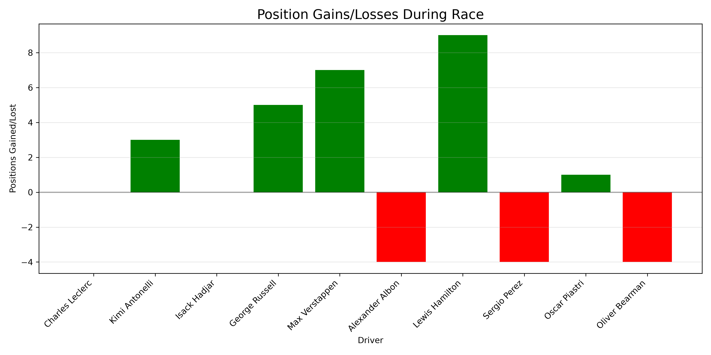<p align="center"><b>Position changes</b></p></td>
<td width="50%">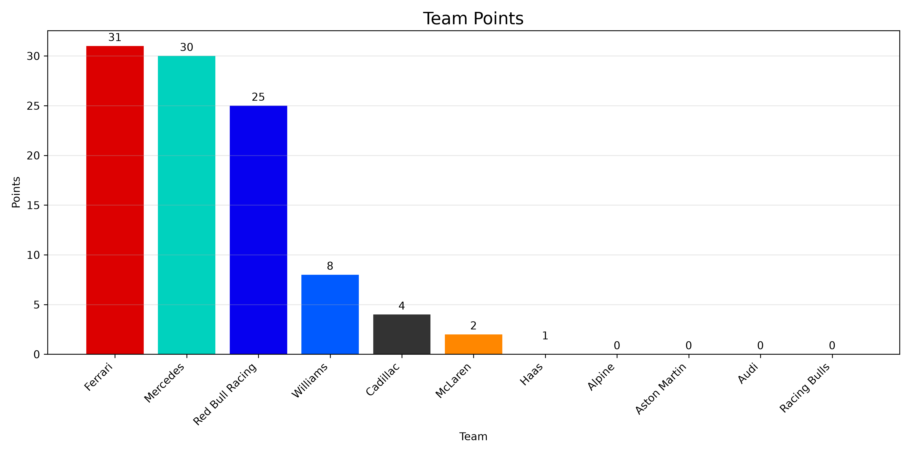<p align="center"><b>Team points</b></p></td>
</tr>
<tr>
<td>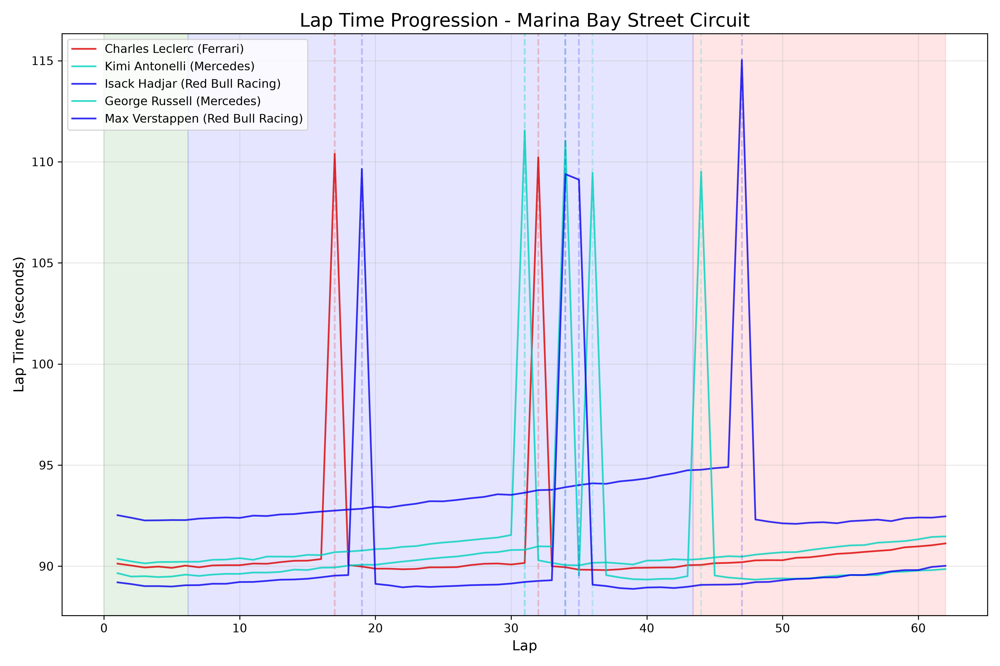<p align="center"><b>Lap time progression</b></p></td>
<td>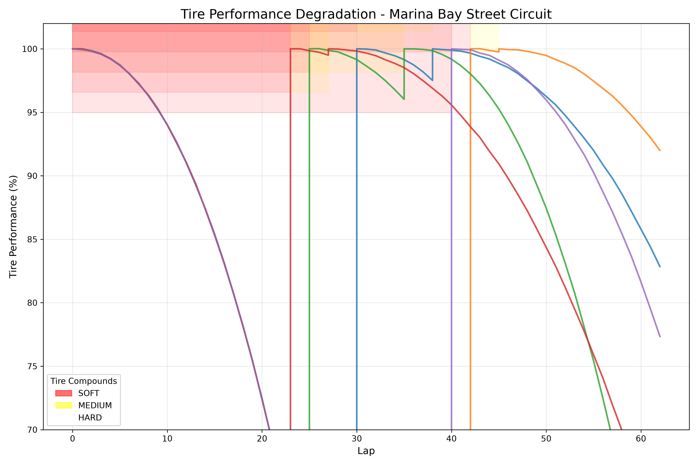<p align="center"><b>Tyre degradation</b></p></td>
</tr>
<tr>
<td>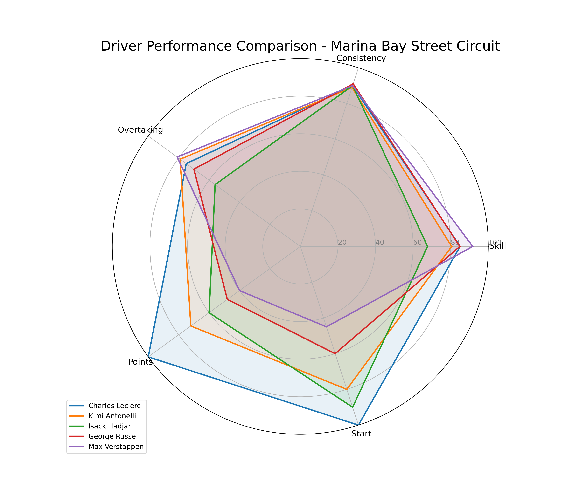<p align="center"><b>Driver radar</b></p></td>
<td>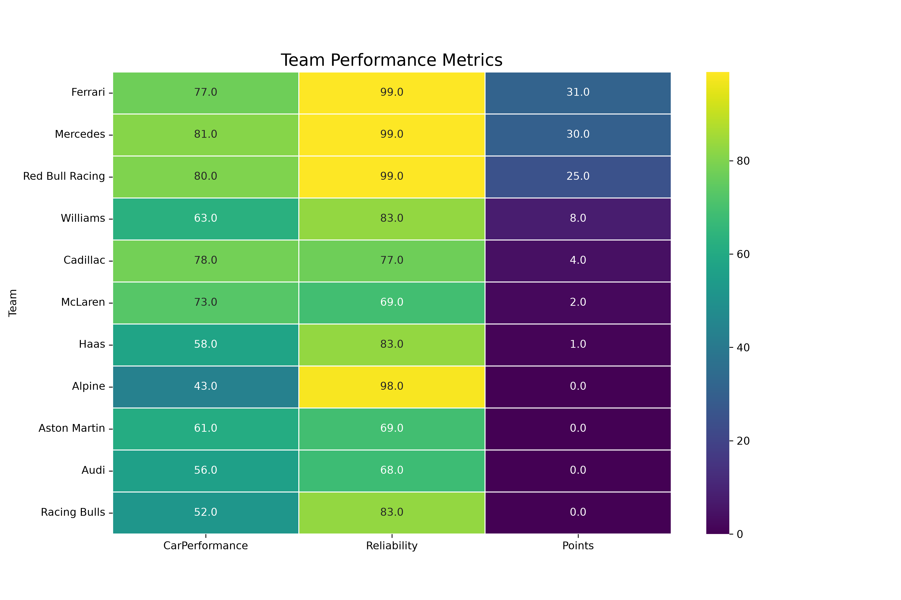<p align="center"><b>Team heatmap</b></p></td>
</tr>
<tr>
<td colspan="2" align="center">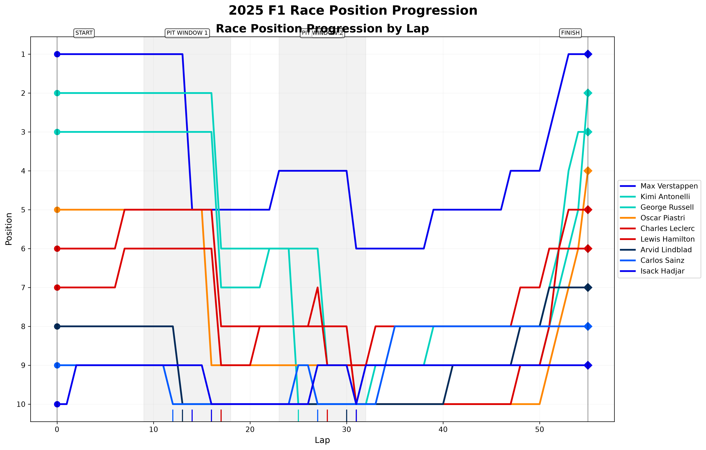<p align="center"><b>Race progress: Red Bull Racing</b></p></td>
</tr>
</table>

---

## 🏁 2026 Grid & Calendar

### Teams

Ratings are the simulator's base values (before real-data blending), on a 0–100 scale.

| Team | Power unit | Race pace | Quali pace | Reliability |
|---|---|:-:|:-:|:-:|
| McLaren | Mercedes | 94.1 | 95.2 | 91 |
| Mercedes | Mercedes | 93.8 | 93.9 | 93 |
| Ferrari | Ferrari | 93.5 | 94.5 | 89 |
| Red Bull Racing | Red Bull Ford | 92.9 | 93.7 | 91 |
| Aston Martin | Honda | 89.6 | 89.9 | 88 |
| Williams | Mercedes | 87.6 | 87.9 | 87 |
| Racing Bulls | Red Bull Ford | 85.7 | 85.8 | 86 |
| Alpine | Renault | 84.3 | 84.8 | 82 |
| Haas | Ferrari | 83.7 | 84.8 | 82 |
| Audi | Audi | 83.5 | 84.4 | 80 |
| Cadillac | Cadillac | 78.3 | 78.5 | 77 |

### Drivers

<details>
<summary><b>Show all 22 drivers</b></summary>

| # | Driver | Team | Nationality | Race rating | Quali rating |
|--:|---|---|---|:-:|:-:|
| 1 | Max Verstappen | Red Bull Racing | Dutch | 94.3 | 95.3 |
| 6 | Isack Hadjar | Red Bull Racing | French | 80.4 | 83.9 |
| 16 | Charles Leclerc | Ferrari | Monegasque | 88.9 | 91.0 |
| 44 | Lewis Hamilton | Ferrari | British | 93.2 | 90.8 |
| 63 | George Russell | Mercedes | British | 90.1 | 91.3 |
| 12 | Kimi Antonelli | Mercedes | Italian | 85.1 | 88.8 |
| 4 | Lando Norris | McLaren | British | 93.5 | 94.2 |
| 81 | Oscar Piastri | McLaren | Australian | 91.1 | 91.4 |
| 14 | Fernando Alonso | Aston Martin | Spanish | 92.0 | 90.1 |
| 18 | Lance Stroll | Aston Martin | Canadian | 78.4 | 79.7 |
| 10 | Pierre Gasly | Alpine | French | 83.7 | 84.8 |
| 43 | Franco Colapinto | Alpine | Argentine | 78.2 | 81.1 |
| 27 | Nico Hulkenberg | Audi | German | 85.1 | 84.2 |
| 5 | Gabriel Bortoleto | Audi | Brazilian | 78.2 | 81.0 |
| 11 | Sergio Perez | Cadillac | Mexican | 85.2 | 83.8 |
| 77 | Valtteri Bottas | Cadillac | Finnish | 84.8 | 84.5 |
| 30 | Liam Lawson | Racing Bulls | New Zealander | 81.3 | 83.0 |
| 17 | Arvid Lindblad | Racing Bulls | British | 77.0 | 80.4 |
| 55 | Carlos Sainz | Williams | Spanish | 89.9 | 89.2 |
| 23 | Alexander Albon | Williams | Thai | 85.3 | 84.8 |
| 31 | Esteban Ocon | Haas | French | 83.8 | 84.2 |
| 87 | Oliver Bearman | Haas | British | 80.9 | 83.5 |

</details>

### Calendar

<details>
<summary><b>Show all 24 races</b></summary>

| # | Circuit | Country | Date | Laps | Length | Type |
|--:|---|---|---|--:|--:|---|
| 1 | Albert Park Circuit | Australia | March 6–8 | 58 | 5.278 km | Medium downforce |
| 2 | Shanghai International Circuit | China | March 13–15 | 56 | 5.451 km | Medium downforce |
| 3 | Suzuka Circuit | Japan | March 27–29 | 53 | 5.807 km | High downforce |
| 4 | Bahrain International Circuit | Bahrain | April 10–12 | 57 | 5.412 km | Medium downforce |
| 5 | Jeddah Corniche Circuit | Saudi Arabia | April 17–19 | 50 | 6.174 km | Low downforce |
| 6 | Miami International Autodrome | USA | May 1–3 | 57 | 5.412 km | Medium downforce |
| 7 | Circuit Gilles Villeneuve | Canada | May 22–24 | 70 | 4.361 km | Medium downforce |
| 8 | Circuit de Monaco | Monaco | June 5–7 | 78 | 3.337 km | High downforce |
| 9 | Circuit de Barcelona-Catalunya | Spain | June 12–14 | 66 | 4.675 km | High downforce |
| 10 | Red Bull Ring | Austria | June 26–28 | 71 | 4.318 km | Medium downforce |
| 11 | Silverstone Circuit | Great Britain | July 3–5 | 52 | 5.891 km | High downforce |
| 12 | Circuit de Spa-Francorchamps | Belgium | July 17–19 | 44 | 7.004 km | Medium downforce |
| 13 | Hungaroring | Hungary | July 24–26 | 70 | 4.381 km | High downforce |
| 14 | Circuit Zandvoort | Netherlands | August 21–23 | 72 | 4.259 km | High downforce |
| 15 | Autodromo Nazionale Monza | Italy | September 4–6 | 53 | 5.793 km | Low downforce |
| 16 | Madrid Street Circuit 🆕 | Spain | September 11–13 | 56 | 5.473 km | Medium downforce |
| 17 | Baku City Circuit | Azerbaijan | September 24–26 | 51 | 6.003 km | Low downforce |
| 18 | Marina Bay Street Circuit | Singapore | October 9–11 | 62 | 4.940 km | High downforce |
| 19 | Circuit of the Americas | USA | October 23–25 | 56 | 5.513 km | Medium downforce |
| 20 | Autódromo Hermanos Rodríguez | Mexico | Oct 30–Nov 1 | 71 | 4.304 km | Medium downforce |
| 21 | Autódromo José Carlos Pace | Brazil | November 6–8 | 71 | 4.309 km | Medium downforce |
| 22 | Las Vegas Strip Circuit | USA | November 19–21 | 50 | 6.120 km | Low downforce |
| 23 | Losail International Circuit | Qatar | November 27–29 | 57 | 5.380 km | High downforce |
| 24 | Yas Marina Circuit | UAE | December 4–6 | 58 | 5.281 km | Medium downforce |

</details>

---

## 📁 Project Structure

```
f1-race-prediction/
├── main.py                        # Entry point: menus, simulation flow, analysis
├── requirements.txt
│
├── data/
│   ├── drivers.py                 # 22 drivers and their ratings
│   ├── teams.py                   # 11 teams and their ratings
│   ├── tracks.py                  # 24 circuits (2026 calendar)
│   └── real_data_integration.py   # FastF1 schedule + Jolpica results/lap times
│
├── models/
│   ├── race_model.py              # Core engine, incidents, assign_points()
│   ├── enhanced_race_model.py     # Real-data + ML pace offsets, post-race adjustments
│   ├── ml_predictor.py            # ML predictions (trained model or synthetic fallback)
│   ├── trained_model.py           # Loads the trained model, rebuilds its features
│   ├── trained/                   # f1_model.joblib + f1_training_data.csv
│   ├── strategy.py                # Tyre strategy and pit stops
│   └── weather.py                 # Weather generation
│
├── notebooks/
│   ├── make_notebook.py           # Source of truth; generates the notebook
│   └── train_f1_model_colab.ipynb # Training notebook for Google Colab
│
├── utils/
│   ├── visualization.py           # Terminal tables, race progress
│   ├── visualization_graphs.py    # PNG charts
│   ├── stats.py                   # Statistics
│   └── loading_screen.py          # Loading animations, log suppression
│
├── docs/screenshots/              # README screenshots
├── visualized-graphs/             # Generated charts
├── cache/                         # Data cache (auto-generated)
└── test_*.py                      # Integration test scripts
```

---

## 🛠️ Troubleshooting

| Problem | Cause | Fix |
|---|---|---|
| `ModuleNotFoundError: No module named 'tabulate'` although `pip` says it is installed | Several Python versions are installed. `pip` installed into one, the program ran with another | Run with the same interpreter: `python -m pip install -r requirements.txt` then `python main.py`. In VS Code: `Ctrl+Shift+P` → **Python: Select Interpreter** |
| `pip install requirements.txt` fails | Missing `-r` flag | `pip install -r requirements.txt` |
| `F1 account email:` prompt | An old version of this project used FastF1's `Session.load()` | Update to the current version; no F1 account is needed |
| First run is slow | ~125 requests to Jolpica | Wait ~2 minutes once; later runs use `cache/` |
| `Invalid request to Ergast` / rate limit | More than ~200 Jolpica requests within an hour (e.g. after deleting `cache/`) | Wait and retry; don't delete `cache/` |
| `Real Pace Applied: False` | No race at this circuit last season (e.g. Madrid) | Expected; the simulation runs without the track offset |
| Warnings when loading the model | Different scikit-learn/XGBoost version | Use scikit-learn 1.6.1 and XGBoost 3.4.1 |

---

## 🗺️ Roadmap

- [x] ML model trained on real 2018–2026 results
- [x] Walk-forward backtest against real results
- [x] Calibrated win & podium probabilities
- [x] Real data without an F1 account (Jolpica)
- [x] Pit stops in the race simulation
- [ ] Compound pace differences, undercut/overcut
- [ ] Safety car and virtual safety car
- [ ] Full-season championship simulation
- [ ] Web dashboard
- [ ] Automated tests and CI with GitHub Actions

---

## 👤 Author

<div align="center">

**Mehmet Kahya**

[](https://github.com/mehmetkahya0)
[](mailto:mehmetkahyakas5@gmail.com)

<br>

*Real data: [FastF1](https://github.com/theOehrly/Fast-F1) · [Jolpica F1 API](https://api.jolpi.ca) · [Open-Meteo](https://open-meteo.com)*

*Not affiliated with Formula 1, the FIA or any F1 team. All predictions are simulations and must not be used for betting or financial decisions.*

</div>
